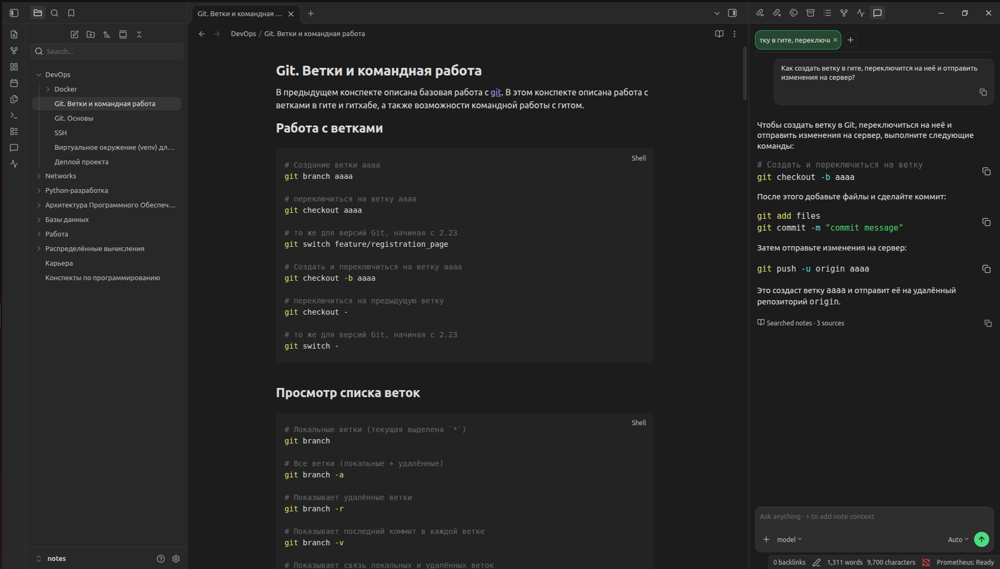

<h1 align="center">Prometheus</h1>

**English:** README.md · **Русский:** [README.ru.md](./README.ru.md)

<p align="center"><strong>Self-hosted AI assistant for your Obsidian notes</strong></p>

Ask questions in natural language. Prometheus searches your notes by meaning, answers only from what it finds, and shows the sources — all on your machine.




**Local First · Offline First · No cloud APIs**

---

## What Prometheus does

Prometheus is an Obsidian Community Plugin plus a local **Prometheus Runtime** sidecar.

You ask something like *"How do I create a branch, switch to it, and push?"* The runtime:

1. runs semantic search over your vault;
2. retrieves the most relevant note chunks;
3. sends that context to a local LLM via [Ollama](https://ollama.com);
4. returns an answer grounded in your notes;
5. cites the sources it used.

Notes, embeddings, the vector index, prompts, and model calls stay on your computer. There is no cloud LLM or cloud embedding path in the base product.

---

## Set up Prometheus

1. Install **[Ollama](https://ollama.com)** and pull a local model. For ordinary laptops, we recommend:

   ```bash
   ollama pull qwen3:4b-instruct-2507-q4_K_M
   ```
2. Install **Prometheus** from Obsidian Community Plugins (or load a release / local build).
3. On first setup, let the plugin download the managed **Prometheus Runtime** binary outside the vault — or point Settings at a custom binary path.
4. Open the Prometheus chat panel from the ribbon or Command Palette.
5. Wait until the status bar shows **Prometheus: Ready**, then ask a question about your notes.

After runtime and models are installed, you can go offline and keep chatting against your vault.

---

## Built around your vault

- **Grounded answers** — the model is instructed to use only retrieved note context. If the vault does not contain enough information, Prometheus says so instead of inventing facts.
- **Cited sources** — every answer links back to the notes that were searched, so you can open and verify them in Obsidian.
- **Semantic search** — find notes by meaning, not only exact keywords; retrieval can also be used without generating a full chat reply.
- **Automatic indexing** — Markdown notes are chunked and embedded locally. Later edits update the index incrementally instead of rebuilding the whole vault.
- **Note context in chat** — add specific notes to the prompt when you need tighter context (`/` note picker in the input bar).
- **Your choice of local model** — pick any Ollama model you already have installed; Prometheus does not hard-code a single LLM.

---

## How it works

```text
Obsidian Community Plugin (TypeScript UI)
            │  localhost
            ▼
Prometheus Runtime (local sidecar)
  · Markdown parse & chunking
  · FastEmbed embeddings
  · sqlite-vec + SQLite index
  · retrieval / optional rerank
            │  localhost
            ▼
         Ollama → local LLM
            │
            ▼
     Answer + note sources
```

The plugin stays thin. Heavy RAG work runs in the managed runtime process; Ollama owns model download and inference.

---

## Privacy

| Stays on your device | Not used in base mode |
| --- | --- |
| Vault Markdown | Cloud LLM APIs |
| Embeddings & vector index | Cloud embedding APIs |
| Chat prompts & answers | Third-party note upload |
| Ollama model weights | Hosted "Prometheus cloud" |

Prometheus is designed so that after the first download of the runtime and models, Wi-Fi can stay off.

---

## Frequently asked questions

**Does Prometheus send my notes to the cloud?**

No. In the base product, indexing, search, and generation run locally through the Prometheus Runtime and Ollama. Your notes are not sent to OpenAI, Anthropic, Google, or similar services.

**Does it work offline?**

Yes, after the runtime binary and embedding/LLM models are installed. Subsequent chat and search do not require internet access.

**Does it work on mobile?**

No. Prometheus is desktop-only: the runtime sidecar and local Ollama process are not available in the Obsidian mobile apps.

**What if the answer is not in my notes?**

Prometheus should refuse to fill gaps from the model's general knowledge and tell you that the vault does not contain enough information.

**Can I use my own runtime binary?**

Yes. Advanced and development setups can point the plugin at a custom `prometheus-runtime` path instead of the managed download location.

---

## Documentation

- [Architecture](./docs/Architecture.md)
- [Project analytics / requirements](./docs/Project_analytics.md)
- [Plugin development notes](./apps/prometheus-plugin/README.md)
- [Runtime notes](./apps/prometheus-runtime/README.md)

---

## License

Licensed under the [Apache License 2.0](./LICENSE).

## Author

Artyom Vlasov
