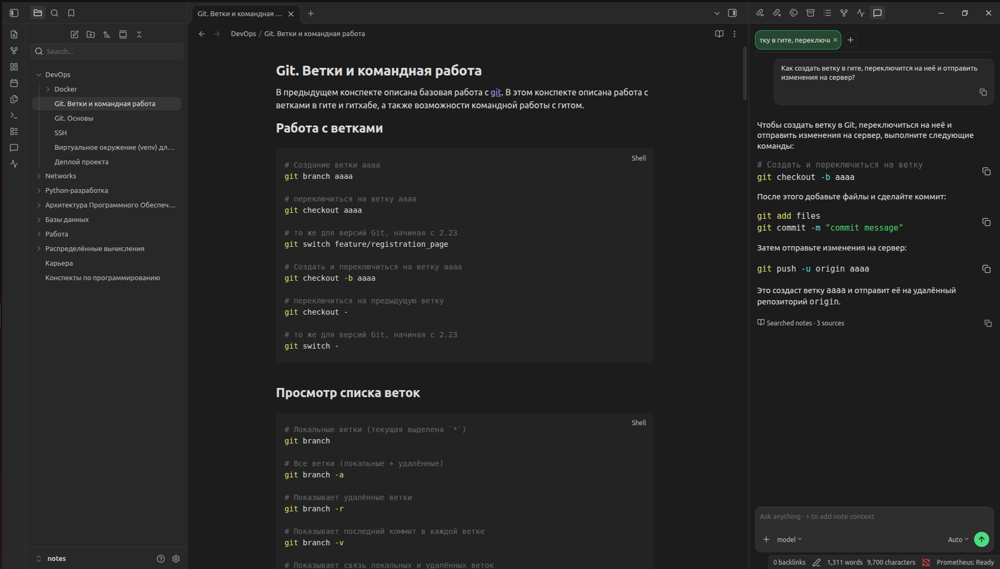

<h1 align="center">Prometheus</h1>

<p align="center"><strong>Локальный AI-чат по вашему vault в Obsidian</strong></p>

--- 

**English:** README.md · **Русский:** [README.ru.md](./README.ru.md)

Задавайте вопросы на естественном языке. Prometheus ищет заметки по смыслу, отвечает только по найденному и показывает источники — всё на вашем компьютере.




**Local First · Offline First · Без облачных API**

---

## Что делает Prometheus

Prometheus — это Community Plugin для Obsidian плюс локальный sidecar **Prometheus Runtime**.

Вы спрашиваете, например: *«Как создать ветку, переключиться на неё и отправить изменения на сервер?»* Runtime:

1. выполняет семантический поиск по vault;
2. достаёт наиболее релевантные фрагменты заметок;
3. передаёт этот контекст локальной LLM через [Ollama](https://ollama.com);
4. формирует ответ на основе ваших заметок;
5. указывает источники, которыми воспользовался.

Заметки, embeddings, векторный индекс, промпты и вызовы модели остаются на вашем компьютере. В базовом режиме нет облачных LLM и облачных embedding API.

---

## Установка Prometheus

1. Установите **[Ollama](https://ollama.com)** и скачайте локальную модель. Для обычных ноутбуков рекомендуем:
   ```bash
    ollama pull qwen3:4b-instruct-2507-q4_K_M
   ```
2. Установите **Prometheus** из Obsidian Community Plugins (или загрузите релиз / локальную сборку).
3. При первой настройке позвольте плагину скачать managed-бинарник **Prometheus Runtime** вне vault — или укажите в Settings свой путь к binary.
4. Откройте панель чата Prometheus из ribbon или Command Palette.
5. Дождитесь статуса **Prometheus: Ready** в status bar и задайте вопрос по своим заметкам.

После установки runtime и моделей можно работать без интернета.

---

## Вокруг вашего vault

- **Ответы по заметкам** — модели даётся инструкция опираться только на найденный контекст. Если в vault недостаточно информации, Prometheus так и говорит, а не выдумывает факты.
- **Источники** — к каждому ответу прилагаются заметки, по которым шёл поиск; их можно открыть и проверить в Obsidian.
- **Семантический поиск** — находите заметки по смыслу, а не только по точным словам; retrieval можно использовать и без полной генерации ответа в чате.
- **Автоматическая индексация** — Markdown-заметки режутся на chunks и эмбеддятся локально. Дальнейшие правки обновляют индекс инкрементально, без полной перестройки vault.
- **Контекст заметок в чате** — при необходимости добавьте конкретные заметки в запрос (`/` выбор заметки в поле ввода).
- **Свой выбор локальной модели** — любая уже установленная модель Ollama; Prometheus не привязан к одной LLM.

---

## Как это устроено

```text
Obsidian Community Plugin (TypeScript UI)
            │  localhost
            ▼
Prometheus Runtime (локальный sidecar)
  · разбор Markdown и chunking
  · embeddings через FastEmbed
  · индекс sqlite-vec + SQLite
  · retrieval / опциональный rerank
            │  localhost
            ▼
         Ollama → локальная LLM
            │
            ▼
     Ответ + источники из заметок
```

Плагин остаётся тонким. Тяжёлый RAG выполняется в managed runtime; загрузкой и запуском моделей занимается Ollama.

---

## Конфиденциальность

| Остаётся на устройстве | Не используется в базовом режиме |
| --- | --- |
| Markdown из vault | Облачные LLM API |
| Embeddings и векторный индекс | Облачные embedding API |
| Промпты и ответы чата | Загрузка заметок на сторонние сервисы |
| Веса моделей Ollama | Hosted «облако Prometheus» |

После первой загрузки runtime и моделей Wi‑Fi можно отключить.

---

## Часто задаваемые вопросы

**Отправляет ли Prometheus мои заметки в облако?**

Нет. В продукте индексация, поиск и генерация идут локально через Prometheus Runtime и Ollama. Заметки не уходят в OpenAI, Anthropic, Google и подобные сервисы.

**Работает ли офлайн?**

Да, после установки binary runtime и моделей для embeddings/LLM. Дальнейший чат и поиск не требуют интернета.

**Есть ли поддержка мобильных устройств?**

Нет. Prometheus только для desktop: sidecar runtime и локальный процесс Ollama недоступны в мобильных приложениях Obsidian.

**Что если ответа нет в моих заметках?**

Prometheus не должен дописывать ответ из общих знаний модели и сообщит, что в vault недостаточно информации.

**Можно ли указать свой binary runtime?**

Да. В advanced/dev-настройках плагин можно направить на свой путь к `prometheus-runtime` вместо managed-загрузки.

---

## Документация

- [Архитектура](./docs/Architecture.md)
- [Аналитика / требования](./docs/Project_analytics.md)
- [Заметки по разработке плагина](./apps/prometheus-plugin/README.md)
- [Заметки по runtime](./apps/prometheus-runtime/README.md)

---

## Лицензия

Распространяется под [Apache License 2.0](./LICENSE).

## Автор

[Власов Артём](https://github.com/Artemiadze) · [репозиторий](https://github.com/Artemiadze/prometheus)

Состав релиза **0.1** зафиксирован в [`docs/release/0.1.md`](./docs/release/0.1.md).
